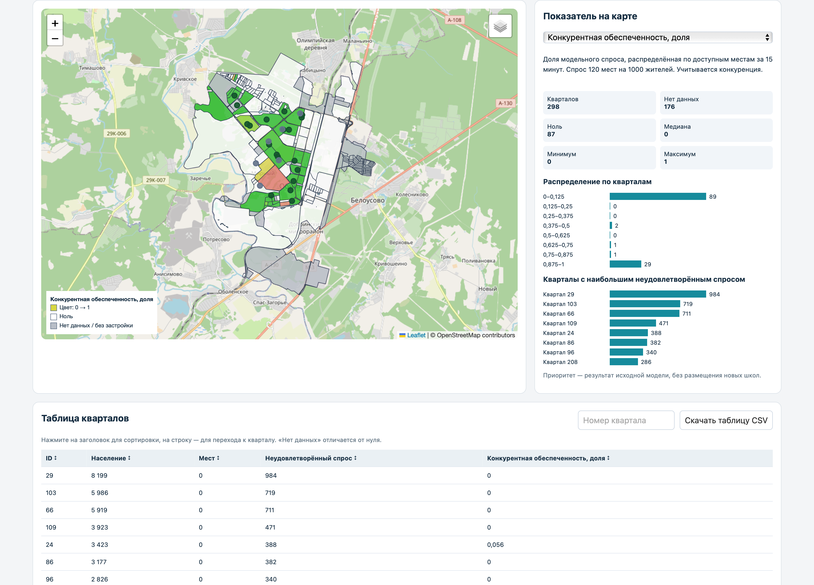
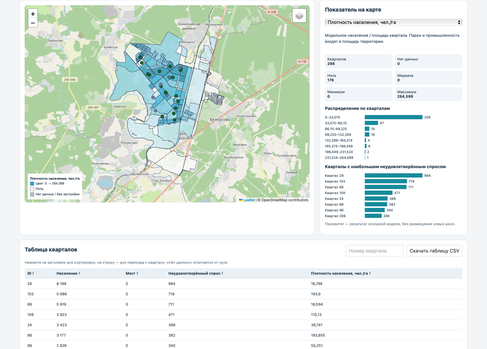
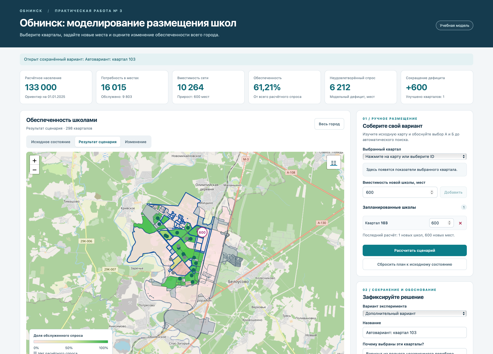
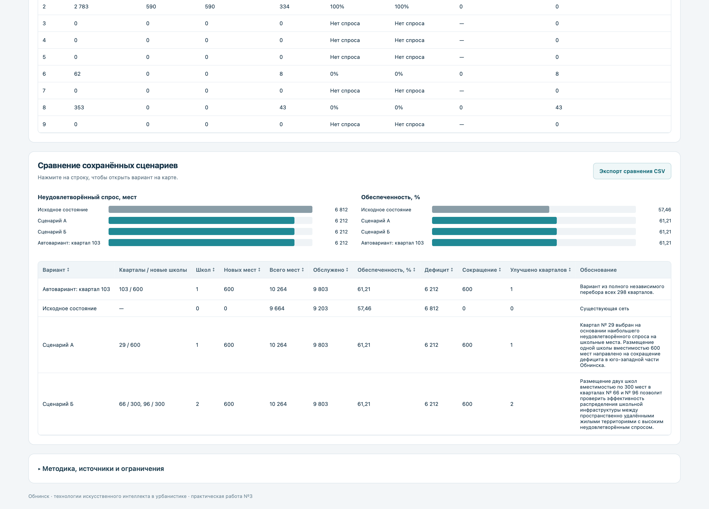

# Пространственный анализ Обнинска и моделирование размещения школ

[**Открыть интерактивный дашборд**](examples/data/obninsk/dashboard.html)
· [**Открыть приложение моделирования размещения школ**](http://127.0.0.1:8765/)

Дашборд — самостоятельный HTML-файл. На GitHub откройте ссылку, скачайте файл кнопкой **Download raw file**
и откройте его в браузере. В локальной копии проекта достаточно открыть `examples/data/obninsk/dashboard.html`.
Приложение работает **локально**: сначала выполните из папки проекта одну команду, затем откройте ссылку выше.

```sh
.venv/bin/python school-placement/obninsk/app.py
```

## О проекте

Исследование городской территории **Обнинска, Калужская область**, и возможностей развития школьной инфраструктуры.
Пространственный анализ связывает структуру кварталов, застройку, распределение населения и пешеходную доступность.
На его основе приложение позволяет сравнивать размещение новых школ с учётом конкуренции за доступные места.

Инструменты: **Python, BlocksNet, GeoPandas, OpenStreetMap, OSMnx и Leaflet**.

## Пространственный анализ городской территории

Сформированы и согласованы **298 городских кварталов**. Для них определены функциональное использование,
характеристики застройки, распределение и плотность населения, показатели Spacematrix — FSI, GSI, MXI, L, OSR —
и морфотипы Spacematrix и «Стрелки». По пешеходной сети рассчитаны время между кварталами,
территориальная доступность и конкурентная обеспеченность школами.

| Итоговый показатель | Значение |
|---|---:|
| Городские кварталы | 298 |
| Модельное население после калибровки | 133 000 человек |
| Общедоступная школьная сеть | 19 муниципальных площадок |
| Вместимость сети | 9 664 места |
| Расчётная потребность | 16 015 мест |
| Удовлетворённый спрос | 9 203 места |
| Исходная обеспеченность | 57,46% |
| Неудовлетворённый спрос | 6 812 мест |
| Матрица пешеходного времени | 298 × 298, минуты |





| Материал | Ссылка | Краткое описание |
|---|---|---|
| Выполненный Jupyter Notebook | [Открыть ноутбук](examples/data/obninsk/obninsk_research.ipynb) | Методика, расчёты, карты и сохранённые результаты |
| Интерактивный дашборд | [HTML-файл](examples/data/obninsk/dashboard.html) | Выбор показателей, карта, статистика и таблица |
| Аналитический отчёт | [REPORT.md](examples/data/obninsk/REPORT.md) | Итоги анализа, калибровка населения и ограничения |
| GeoJSON кварталов | [blocks_results.geojson](examples/data/obninsk/practice3/blocks_results.geojson) | 298 кварталов с ID и итоговыми характеристиками |
| GeoJSON школ | [schools.geojson](examples/data/obninsk/practice3/schools.geojson) | Размещение школ, вместимость и происхождение оценок |
| Пространственные показатели | [blocks_results.csv](examples/data/obninsk/practice3/blocks_results.csv) | Население, застройка, морфотипы и обеспеченность |
| Транспортная доступность | [travel_time_minutes.csv](examples/data/obninsk/practice3/travel_time_minutes.csv) | Сетевое время между кварталами; строки и столбцы соответствуют block_id |
| Данные для моделирования | [Папка данных](examples/data/obninsk/practice3/) | Согласованные входные данные, параметры спроса и исходное распределение мест |

## Моделирование размещения школ

Интерактивное приложение позволяет выбирать кварталы на карте, добавлять школы, изменять их вместимость,
пересчитывать обеспеченность всего города, сохранять и сравнивать сценарии. Автоматический поиск независимо
проверяет все 298 кварталов для одной школы заданной вместимости. Карта показывает исходное состояние,
сценарий и пространственные изменения; таблицы доступны для экспорта.

В проведённом эксперименте ручные варианты А и Б выбраны и обоснованы **до автоматического поиска**.
Население, существующие школы, матрица времени и параметры расчёта во всех вариантах одинаковы.





| Состояние | Новые школы | Всего мест | Обслуженный спрос | Обеспеченность | Дефицит | Сокращение дефицита |
|---|---|---:|---:|---:|---:|---:|
| Исходное | — | 9 664 | 9 203 | 57,46% | 6 812 | — |
| А | №29: 600 мест | 10 264 | 9 803 | 61,21% | 6 212 | 600 |
| Б | №66 и №96: по 300 мест | 10 264 | 9 803 | 61,21% | 6 212 | 600 |
| В | №103: 600 мест, автоматический выбор | 10 264 | 9 803 | 61,21% | 6 212 | 600 |

**По сокращению суммарного дефицита три варианта равноэффективны.** Обеспеченность возрастает на 3,75 п.п.,
дефицит сокращается на 8,81%. В А улучшается квартал №29, в Б — №66 и №96, в В — №103.
Дефицит сохраняется в 95 кварталах; две школы распределяют эффект между двумя территориями,
но в этом эксперименте не дают большего суммарного выигрыша.

Полный перебор завершён без ошибок и выявил **69 равноценных оптимальных кварталов**; ручной №29 входит
в их число. Разные положения школы позволяют обслужить одинаковый дополнительный спрос на школьные места,
в том числе через перераспределение существующих мест. Это равенство по принятому критерию,
а не подтверждение равноценности участков для строительства.

| Материал | Ссылка | Краткое описание |
|---|---|---|
| Интерактивное приложение | [Открыть локально](http://127.0.0.1:8765/) · [Инструкция запуска](school-placement/obninsk/README.md) | Требует предварительного запуска Python-сервера; не общедоступный сайт |
| Исходный код | [Папка приложения](school-placement/obninsk/) · [Модель](school-placement/obninsk/model.py) | Локальный сервер, расчёт BlocksNet и интерфейс Leaflet |
| Аналитический отчёт | [REPORT.md](school-placement/obninsk/REPORT.md) | Обоснования выбора, сравнение, пространственные эффекты и разбор 69 оптимумов |
| Сравнение сценариев | [scenario_comparison.csv](school-placement/obninsk/results/final/scenario_comparison.csv) | Исходное состояние, А, Б и В со всеми итоговыми метриками |
| Сохранённые сценарии | [scenarios.json](school-placement/obninsk/results/scenarios.json) | Пользовательские планы, обоснования и поквартальные результаты |
| Автоматический перебор | [Все 298 вариантов](school-placement/obninsk/results/final/automatic_all_298.csv) · [69 оптимумов](school-placement/obninsk/results/final/equivalent_optimal_69.csv) | Полный независимый перебор и диагностика равноценных решений |
| Проверка работоспособности | [Проверка итогов](school-placement/obninsk/results/final/verification.json) · [Проверка браузера](school-placement/obninsk/results/browser_check.json) | Воспроизведение расчётов, сохранность данных и проверки интерфейса |

## Основные результаты

- Сформирована единая пространственная основа: кварталы, население, школьные мощности и сетевое время.
- Исходная обеспеченность составляет **57,46%**, модельный дефицит — **6 812 мест**.
- Добавление 600 мест в каждом выбранном сценарии повышает обеспеченность до **61,21%**.
- Автоматический поиск подтверждает эффективность ручного варианта №29, но не выделяет единственный лучший квартал.
- При одинаковом общем результате новые школы дают различный локальный эффект; это видно на карте и в поквартальных таблицах.

## Материалы проекта

Основные материалы пространственного анализа находятся в [examples/data/obninsk/](examples/data/obninsk/),
приложение и результаты эксперимента — в [school-placement/obninsk/](school-placement/obninsk/).
[Полная поквартальная таблица четырёх состояний](school-placement/obninsk/results/final/quarters_all_scenarios.csv)
и [остаточный дефицит](school-placement/obninsk/results/final/remaining_deficit.csv) дополняют итоговый отчёт.

Сохранённые карты и результаты доступны без повторного расчёта. Для локального приложения используются готовые
данные; повторная загрузка OSM не требуется. В публикацию не включены окружение, кэш, временные тестовые сохранения,
сырые XML-выгрузки и полный архив первоначальных результатов. Полный повтор исторического ноутбука потребует
этих локальных исходников; для просмотра выполненного ноутбука, дашборда и работы приложения они не нужны.
Исследование Кореновска сохранено в репозитории отдельно и не изменяется этой публикацией.

## Источники данных и ограничения

Геометрия, застройка, функциональные зоны и пешеходная сеть основаны на
[OpenStreetMap](https://www.openstreetmap.org/relation/3396088).
© [OpenStreetMap contributors](https://www.openstreetmap.org/copyright), данные распространяются по ODbL.
Источники населения — [статистика администрации Обнинска](https://obninsk.ru/obninsk/economic-development/stat/),
школьной сети — [муниципальный каталог](https://www.obninsk.ru/obninsk/social-sphere/education/Obninskschools/)
и ссылки на мощности отдельных корпусов в [каталоге школ](examples/data/obninsk/school_catalog.csv).

Население **133 000** — условное распределение округлённого ориентира на 01.01.2025 по уточнённой жилой площади,
а не официальная статистика кварталов. Часть школьных мощностей оценена по площади зданий;
фактическое количество учащихся не используется как вместимость.

Пешеходный граф самостоятельно построен OSMnx: скорость **4,5 км/ч**, порог доступности **15 минут**.
Конкурентная модель BlocksNet использует **120 мест на 1 000 жителей**, `self_supply=True`, `max_depth=1`;
подходы к узлам и внутриквартальные пути не включены во время. Модель не учитывает все ограды, возрастной состав,
заселённость новостроек, стоимость строительства и наличие подходящих земельных участков.
Результаты служат для пространственного сравнения вариантов и не являются готовым градостроительным решением.
